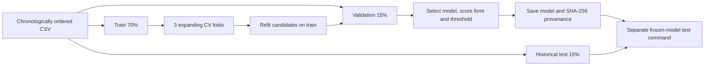

# Customer Subscription Prediction

An end-to-end machine learning portfolio project that ranks customers for a bank term-deposit campaign using **Python, pandas and scikit-learn**. It covers data exploration, chronological evaluation, model tuning, calibration diagnostics, illustrative contact costs and batch CSV inference.

**Main result:** tuned Logistic Regression achieved **0.2077 validation average precision** and **1.983× lift in the top 20%**. Historical test lift fell to **1.168×** as the positive rate changed sharply. This project documents that limitation alongside the results.

[Portfolio report (Tiếng Việt)](docs/portfolio_report.md) · [Experiment findings](docs/milestone3_findings.md) · [Model card](docs/model_card.md) · [Changelog](CHANGELOG.md)

## Problem and prediction point

Given customer information and campaign history, produce a subscription score, a yes/no label and a ranked contact list. Scoring assumes the upcoming call has been scheduled but has **not started**.

The dataset is [UCI Bank Marketing](https://archive.ics.uci.edu/dataset/222/bank+marketing), specifically `bank-additional-full.csv`: 41,188 historical records from a Portuguese bank. The target is whether a customer subscribed to a term deposit. The post-call feature `duration` is excluded, leaving 19 inputs. Availability of campaign counters, scheduled contact fields and economic releases remains conditional; see the [model card](docs/model_card.md).

## Measured results

All model decisions use train/validation. The test period had already been inspected during baseline/EDA, so it is **not an untouched independent holdout**. No confidence intervals were estimated.

| Model / period | Average precision | Precision, top 20% | Lift, top 20% |
| --- | ---: | ---: | ---: |
| Dummy / validation | 0.1065 | 12.14%¹ | 1.139×¹ |
| Baseline Logistic Regression / validation | 0.1902 | 20.95% | 1.967× |
| Baseline Random Forest / validation | 0.1718 | 17.23% | 1.618× |
| **Tuned Logistic Regression / validation** | **0.2077** | **21.12%** | **1.983×** |
| Frozen tuned Logistic Regression / historical test | 0.4508 | 44.90% | 1.168× |

¹ Dummy scores are tied; stable row-order tie breaking explains its apparent lift. It has no ranking skill. Random selection has expected lift 1.

The selected pipeline uses `C=0.1`, `class_weight=None` and raw scores. Validation AP improved by 0.0175 over baseline Logistic Regression; precision at the contact budget improved by only 0.16 percentage points. A temporal sigmoid ensemble had worse validation Brier loss, so raw scores were retained.

The positive rate is **5.57% train → 10.65% validation → 38.45% test**. Higher test AP is not evidence of improved generalization. At the fixed threshold `0.153142`, test contact volume reached 49.72%; a threshold selected with a validation budget does not enforce that budget on future batches. Scores are not established as reliable future probabilities; cost-based utility is illustrative, not measured profit.


Full precision values and provenance are committed in [docs/results](docs/results/README.md). Raw data, serialized models and row-level real-data predictions are regenerated locally.

## Quickstart

Requires **Python 3.11+** and Internet access to install dependencies and download UCI data. The recorded experiment environment used Python 3.13.9 on Windows. Run commands from the repository root.

```bash
git clone https://github.com/nhbl-ai/customer-subscription-prediction.git
cd customer-subscription-prediction
python -m venv .venv
```

Windows / PowerShell (no activation or execution-policy change needed):

```powershell
.\.venv\Scripts\python.exe -m pip install -r requirements.txt
.\.venv\Scripts\python.exe tools/download_data.py
.\.venv\Scripts\python.exe -m subscription_prediction.train --config configs/default.json
.\.venv\Scripts\python.exe -m subscription_prediction.predict --input data/examples/customers.csv --output reports/customer_priorities.csv --top-k 2
```

macOS / Linux:

```bash
.venv/bin/python -m pip install -r requirements.txt
.venv/bin/python tools/download_data.py
.venv/bin/python -m subscription_prediction.train --config configs/default.json
.venv/bin/python -m subscription_prediction.predict --input data/examples/customers.csv --output reports/customer_priorities.csv --top-k 2
```

This is the batch CLI demo. The three example customers are **synthetic**, used only to demonstrate inference. The baseline command trains three models and writes a model artifact and reports; it does not reproduce the tuned results above. The project has no hosted app or API.

If the downloader cannot reach UCI, download the archive from the dataset page and extract **`bank-additional-full.csv`** to `data/raw/`. `bank-full.csv` has a different schema.

## Reproduce the full experiment

After downloading data, install the experiment and EDA extras. The following commands use PowerShell; on macOS/Linux replace `.\.venv\Scripts\python.exe` with `.venv/bin/python`.

```powershell
.\.venv\Scripts\python.exe -m pip install -e ".[experiments,eda]"
.\.venv\Scripts\python.exe tools/run_eda.py
.\.venv\Scripts\python.exe -m subscription_prediction.experiments --config configs/milestone3.json
# After reviewing and freezing validation decisions:
.\.venv\Scripts\python.exe -m subscription_prediction.experiments --config configs/milestone3.json --evaluate-test
.\.venv\Scripts\python.exe -m subscription_prediction.predict --model artifacts/milestone3/model.joblib --input data/examples/customers.csv --output reports/milestone3/customer_priorities.csv
.\.venv\Scripts\python.exe tools/export_portfolio.py
```

The full experiment includes Random Forest grid searches and takes longer than the baseline. Export verifies the frozen data/config/model/report hashes and test-selection identity, then writes aggregate tables, figures and portable JSON to `docs/results/`. It does not refit or select models. Running EDA updates the executed notebook and findings.

For the recorded dependency versions, use [requirements-lock.txt](requirements-lock.txt) with Python 3.13 on Windows, then install the project with `python -m pip install -e . --no-deps`. This file is a version snapshot from `pip freeze`, not a cross-platform or hash-locked resolver output. Other supported Python versions resolve dependencies from `pyproject.toml`; small numerical differences may occur.

See [the experiment guide](docs/milestone3_guide.md) for feature ablations, cost scenarios and artifact integrity checks.

## Evaluation design



- Outer split: 28,831 train / 6,178 validation / 6,179 test rows, preserving the source order described by UCI. Row blocks are not equal calendar intervals.
- Preprocessing: numeric median imputation and scaling; categorical imputation and one-hot encoding with unseen-category handling. All fitting occurs inside each training fold.
- Comparison: Dummy, Logistic Regression and Random Forest; 3 feature sets; 27 grid candidates × 3 folds. Models are selected using validation average precision, rather than accuracy under class imbalance.
- Decisions: compare raw scores and temporal sigmoid calibration using validation Brier loss; choose a threshold using historical-label utility under a 20% validation contact budget. Cost/value ratios 1:5, 1:10 and 1:20 are illustrative.
- Diagnostics: precision–recall, permutation importance, calibration bins, group errors and contiguous validation blocks. Test scoring loads the frozen artifact and checks hashes; it never refits.

Validation is reused for several decisions, so these are exploratory portfolio estimates. A new future period and verified feature availability are required before operational use.

## CSV inference contract

Input uses `;` by default and must contain all columns in the trained artifact. `y` and `duration` are unnecessary. Additional fields such as `customer_id` are preserved in output but are not model features unless present during training. Use `--separator ','` for a comma-separated input.

Output is comma-separated and sorted by decreasing `subscription_score`. It adds:

| Column | Meaning |
| --- | --- |
| `priority_rank` | Rank within the input batch, starting at 1 |
| `source_row` | Original zero-based input row position; not a customer ID |
| `subscription_score` | Positive-class `predict_proba` score |
| `predicted_subscription` | `yes` / `no` at the saved validation threshold |

`--top-k N` limits the ranked CSV to N rows. It does not change the saved decision threshold; a top-ranked row can still have a `no` label. Equal scores retain source order. Output retains supplied fields, so handle customer data appropriately. Load only trusted `joblib` artifacts because loading pickle-based files can execute code.

## Repository map

```text
configs/                       Baseline and controlled experiment configurations
data/examples/customers.csv    Synthetic inference example
src/subscription_prediction/
  data.py, modeling.py          Loading, splitting and preprocessing pipelines
  train.py, predict.py          Baseline training and batch inference
  tuning.py, experiments.py    Train-only tuning and frozen test evaluation
  evaluation.py, diagnostics.py Metrics, costs, calibration and error analysis
  eda.py                       Reusable exploration functions
notebooks/01_eda.ipynb          Executed exploration notebook
docs/results/                  Committed aggregate tables, figures and provenance
docs/                          Findings, model card, portfolio and release notes
tools/                         UCI download, notebook execution and result export
tests/                         Behavioral and integration tests with synthetic data
.github/workflows/ci.yml        Python 3.11/3.13 on Ubuntu and Windows
```

Generated outputs: baseline → `artifacts/` and `reports/`; controlled experiment → `artifacts/milestone3/` and `reports/milestone3/`; EDA → `reports/eda/`. These runtime directories are Git-ignored.

## Checks and milestone status

```powershell
.\.venv\Scripts\python.exe -m pip install -e ".[experiments]"
.\.venv\Scripts\python.exe -m unittest discover -s tests -v
.\.venv\Scripts\python.exe -m pip check
```

Tests use synthetic data, including end-to-end baseline training/inference, unseen categories, temporal fold isolation, threshold ties, no-call decisions, frozen test scoring and changed-data rejection. CI is configured to run these checks and build a wheel; its remote status is visible after pushing.

All four planned portfolio milestones are implemented: EDA, reproducible baseline, controlled experiments, and public portfolio packaging. See [the completed plan](docs/project_plan.md). Operational validation, a new independent holdout and a hosted demo remain possible extensions.

## Attribution and license

Project code: [MIT](LICENSE). The source dataset has a separate **CC BY 4.0** license: Moro, S., Rita, P., & Cortez, P. (2014), *Bank Marketing*, UCI Machine Learning Repository, [DOI: 10.24432/C5K306](https://doi.org/10.24432/C5K306). The committed notebook, aggregate tables and figures are analyses of that dataset; transformations include removing `duration`, encoding the target and splitting by row order. The dataset's attribution requirements continue to apply.

This is an educational portfolio on historical campaign data, with no claim of measured business impact or deployment readiness.
