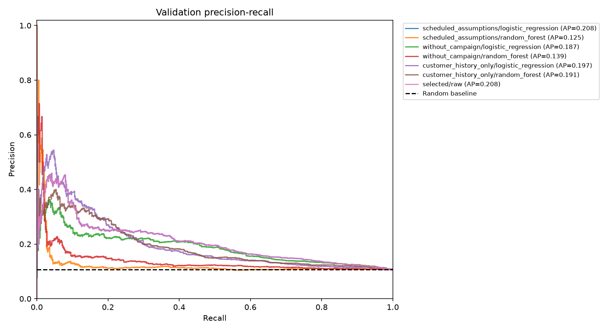
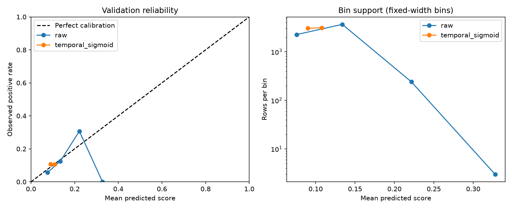
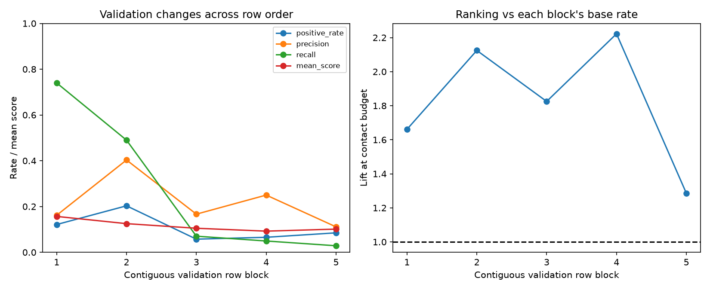
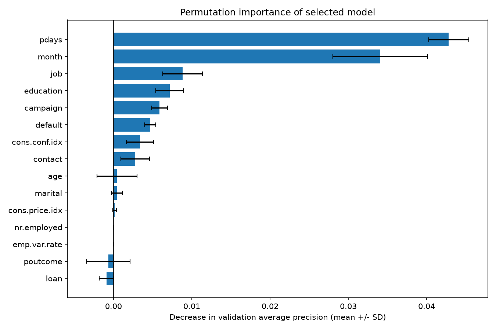

# Portfolio — Dự đoán đăng ký tiền gửi

## Bài toán và sản phẩm

Xếp hạng khách hàng để hỗ trợ lựa chọn danh sách liên hệ trước cuộc gọi.
Sản phẩm là pipeline Python/scikit-learn, notebook EDA, bộ thí nghiệm có cấu hình,
báo cáo tổng hợp và CLI nhận/trả CSV. Dự án dùng dữ liệu lịch sử, chưa triển khai
chiến dịch thực tế. [README](../README.md) có hướng dẫn chạy trên Windows và Linux/macOS.

Nguồn: [UCI Bank Marketing](https://archive.ics.uci.edu/dataset/222/bank+marketing),
Moro, Rita & Cortez (2014), [DOI](https://doi.org/10.24432/C5K306), CC BY 4.0.
Sử dụng đúng `bank-additional-full.csv`, 41.188 dòng; không dùng bản `bank-full.csv`.

## Những quyết định kỹ thuật chính

1. **Ngăn rò rỉ sau cuộc gọi:** bỏ `duration`, xác định thời điểm dự đoán sau lập lịch
   nhưng trước cuộc gọi. Khả dụng của campaign/lịch/chỉ báo kinh tế vẫn là giả định cần xác minh.
2. **Đánh giá theo thứ tự thời gian:** chia 70/15/15 theo dòng; tuning bằng ba fold
   TimeSeriesSplit mở rộng chỉ bên trong train. Không suy ra ngày đầy đủ từ month/day_of_week.
3. **Tiền xử lý trong Pipeline:** imputer, scaler, one-hot encoder fit lại trong mỗi fold;
   encoder xử lý được nhóm phân loại chưa xuất hiện lúc train.
4. **Đối chứng và ablation:** Dummy, Logistic Regression, Random Forest; ba nhóm biến;
   có/không class_weight. Chọn bằng AP validation, ghi cả cấu hình không cải thiện.
5. **Tách xếp hạng và quyết định:** precision/lift top 20% đánh giá xếp hạng; ngưỡng
   đánh giá nhãn và utility. Ngưỡng theo chi phí có phương án không gọi, không tách điểm hòa.
6. **Đóng băng trước test:** lưu model, ngưỡng và SHA-256; lệnh test riêng không fit,
   kiểm tra thay đổi dữ liệu/config/artifact/báo cáo trước khi chấm.

## Kết quả đã đo

Các bảng gốc nằm trong [snapshot](results/README.md), diễn giải đầy đủ trong
[milestone3_findings.md](milestone3_findings.md).

| Chỉ số | Baseline LR validation | Tuned LR validation | Tuned LR historical test |
| --- | ---: | ---: | ---: |
| AP | 0,1902 | **0,2077** | 0,4508 |
| Precision top 20% | 20,95% | **21,12%** | 44,90% |
| Lift top 20% | 1,967× | **1,983×** | 1,168× |
| Tỷ lệ yes nền | 10,65% | 10,65% | 38,45% |

Mô hình được chọn là Logistic Regression, `C=0.1`, `class_weight=None`, giữ 19 biến
sau khi bỏ duration. AP tăng 0,0175; precision theo ngân sách tăng khoảng 0,16 điểm
phần trăm. Chưa có khoảng tin cậy, nên chưa kết luận khác biệt có ý nghĩa thống kê.

Raw score có Brier validation 0,09185, tốt hơn temporal sigmoid ensemble 0,09531.
Giữ raw score; đây không phải chứng minh xác suất đúng ở mọi nhóm hoặc giai đoạn mới.

Với chi phí/giá trị minh họa 1:10, ngưỡng 0,153142 chọn 1.064/6.178 người validation,
trong đó 246 yes: precision 23,12%, recall 37,39%, F1 0,2857. Utility proxy là 1.396
đơn vị giả định. Đây là tổng từ nhãn lịch sử, không phải lợi nhuận tăng thêm do gọi.

## Ví dụ lỗi và thay đổi theo thời gian

Ở cùng ngưỡng validation, nhóm `month=apr` có recall 75,75% (301 yes), trong khi
`month=may` chỉ 5,04% (357 yes): 339 yes bị bỏ sót trong nhóm tháng 5. Đây là một
ví dụ lỗi tổng hợp, không chọn một khách hàng thật để suy diễn nguyên nhân.
Tháng không có năm đầy đủ và các biến thay đổi cùng nhau; khác biệt không chứng minh
quan hệ nhân quả hoặc một kết luận công bằng đã hoàn chỉnh.

Recall giảm từ 74,00% ở khối validation đầu xuống 2,86% ở khối cuối tại ngưỡng cố định,
trong khi lift top 20% mỗi khối vẫn trên 1. Khả năng xếp hạng và tính phù hợp của ngưỡng
có thể thay đổi khác nhau.

Permutation importance: hoán vị `pdays` giảm AP trung bình 0,04283, `month` giảm 0,03410.
Các biến tương quan có thể che tầm quan trọng nhau; `pdays=999` là sentinel được giữ như baseline.

## Giới hạn quyết định cách diễn giải

- Test đã được xem ở baseline/EDA; không phải holdout độc lập chưa từng xem.
- Tỷ lệ yes thay đổi 5,57% train → 10,65% validation → 38,45% test. AP test cao hơn
  không chứng minh khả năng tổng quát hóa tốt hơn; lift test giảm còn 1,168×.
- Ngưỡng cố định chọn 49,72% test, dù được chọn dưới ngân sách 20% validation.
  Chính sách top-k theo batch và ngưỡng phân loại là hai lựa chọn khác nhau.
- Brier test là 0,27497; score trung bình 19,05% thấp hơn tỷ lệ yes 38,45%.
  Chưa thể dùng score làm xác suất đăng ký đáng tin trong giai đoạn này.
- Validation được dùng lại cho nhiều quyết định; thiếu khoảng tin cậy và dữ liệu tương lai mới.
- Thiếu customer ID, ngày đầy đủ và dữ liệu tại thời điểm công bố; chưa loại trừ
  khách hàng lặp hoặc nhãn trễ. Nguồn lịch sử Bồ Đào Nha không đại diện mọi thị trường.

## Khả năng tái lập và kiểm tra

Config được lưu trong repo. [requirements-lock.txt](../requirements-lock.txt) ghi phiên bản
từ môi trường Python 3.13.9/Windows dùng cho dự án. Notebook và báo cáo có thể sinh lại;
snapshot công khai có hash để đối chiếu. Exporter xác minh provenance trước khi xuất,
giữ nguyên số liệu và thay các đường dẫn máy cá nhân bằng đường dẫn config tương đối.

Kiểm thử dùng dữ liệu giả lập để kiểm tra ngưỡng so với vét cạn, điểm hòa, no-call,
thứ tự fold/gap, nhóm một nhãn, tuning không dùng test, test không refit,
đổi dữ liệu bị từ chối và luồng train/inference với category mới.
CI đã được cấu hình; trạng thái chạy từ xa cần xem trên GitHub sau khi push.

## Cách ghi vào CV

**Customer Subscription Prediction | Python, pandas, scikit-learn, GitHub Actions**

- Built a reproducible ML pipeline on 41,188 UCI Bank Marketing records, excluding post-call duration and using chronological train/validation/test splits.
- Compared three model families with expanding-window cross-validation and feature ablations; tuned Logistic Regression achieved 0.2077 validation AP and 1.98× lift among the top 20% in offline evaluation.
- Implemented calibration/error diagnostics, illustrative cost-based thresholds, frozen-artifact test evaluation and ranked CSV inference with automated tests.

Khi phỏng vấn, giải thích luôn lift historical test chỉ 1,17× dưới thay đổi phân bố.
Không chuyển các metric này thành tuyên bố tăng doanh thu, tiết kiệm thực tế hay hệ thống production.
